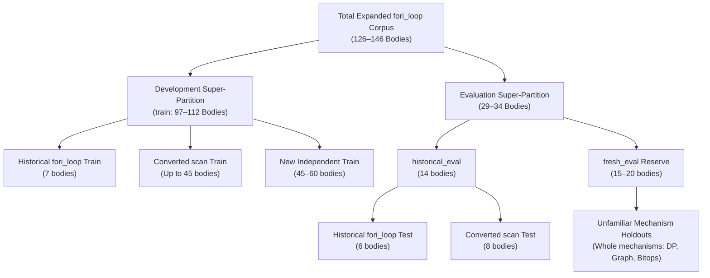
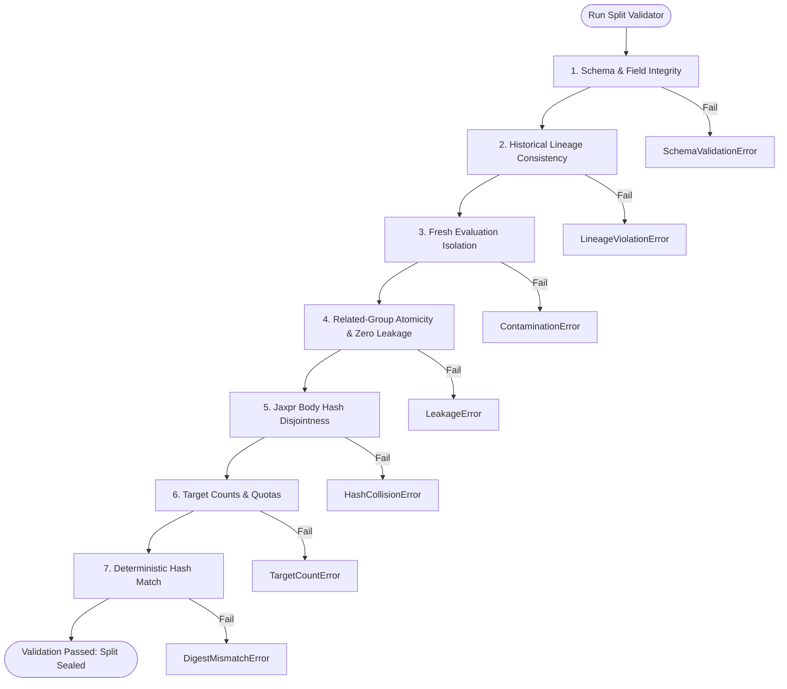

# Loop Unrolling Corpus Expansion: Split Design & Evaluation Protocol

This specification establishes the architectural rules, partition hierarchy, allocation protocols, schema definition, and deterministic verification algorithm for the expanded JAX `lax.fori_loop` benchmarking corpus.

---

## 1. Executive Summary & Core Objectives

### 1.1 Context
The JAX loop-unrolling benchmark predicts steady-state execution time on Apple M2 CPU across static loop unroll factors $\mathcal{U} \in \{1, 2, 4, 8\}$. While the historical dataset spans 66 measured workloads across legacy, recovery, structured, and indirect suites, only 13 workloads were native `fori_loop` bodies (7 training, 6 test), and 53 were implemented as `lax.scan`. Furthermore, 35 bodies possessed only a single measured configuration.

### 1.2 Core Mandate
1. **Fori_loop-Only Deliverable**: All 53 historical scan workloads are audited for conversion into native, static-bound `fori_loop` bodies with fixed-shape carries.
2. **Expansion with 60–80 Genuinely New Bodies**: Broaden the algorithmic scope across 10 distinct computational workstreams.
3. **Partition Hierarchy with Rigorous Isolation**:
   - **`train` (Development)**: Carries forward historical training lineage (7 historical fori_loops + up to 45 converted scans) plus 45–60 genuinely new bodies.
   - **`historical_eval` (Historical Evaluation)**: Preserves historical test relatives (6 historical fori_loops + 8 converted scans) to guarantee historical backward-compatibility and continuity.
   - **`fresh_eval` (Fresh Evaluation Reserve)**: 15–20 genuinely new independent bodies reserved strictly for evaluating out-of-distribution generalization on unseen algorithms and novel mechanisms.
4. **Zero-Leakage Invariant**: Every `related_group` ID must reside 100% in development or 100% in evaluation. Zero cross-boundary leakage of algorithms, datasets, or Jaxpr body hashes.
5. **Deterministic Hash Verification**: Split assignments and manifests are sealed cryptographically via SHA-256 digests computed over canonically formatted tuples.

---

## 2. Partition Hierarchy & Target Counts



### 2.1 Target Counts Breakdown

| Partition | Category | Source Origin | Expected Distinct Bodies | Measurement Role |
|---|---|---|:---:|---|
| **`train`** (Development) | Historical `fori_loop` | Frozen Phase 1/2/3 | **7** | Anchor historical development baseline |
| | Converted `scan` | Phase 1/2/3 Train Scans | **45** (max) | Converted paired controls; preserves training distribution |
| | New Independent | 10 Expansion Workstreams | **45–60** | Feature exploration, cross-validation, model fitting |
| *Subtotal: Development* | | | **97–112** | Model training & hyperparameter search |
| **`historical_eval`** | Historical `fori_loop` | Frozen Phase 1/2/3 | **6** | Exact historical holdout test set continuity |
| | Converted `scan` | Phase 1/2/3 Test Scans | **8** | Preserves historical evaluation benchmark once converted |
| *Subtotal: Historical Eval* | | | **14** | Evaluates backward compatibility & translation stability |
| **`fresh_eval`** | New Independent | Unfamiliar-Family Holdouts | **15–20** | Pristine out-of-distribution test set; unobserved mechanisms |
| *Subtotal: Evaluation* | | | **29–34** | Strict blinded performance scoring |
| **Total Benchmark** | | | **126–146** | Full fori_loop unrolling matrix |

---

## 3. Split Rules & Protocol

### 3.1 Historical Lineage Preservation Protocol

The corpus carries forward 66 historical loop workloads. The split rules strictly prevent any historical data leakage across partition boundaries:

1. **Immutable Historical Assignment**:
   - For every historical workload $w \in \mathcal{W}_{\text{hist}}$, let $P_{\text{hist}}(w) \in \{\text{train}, \text{test}\}$ denote its assignment in `results/all_workloads/split.csv`.
   - The expanded partition $P(w)$ must strictly satisfy:
     $$P(w) = \begin{cases} \text{train} & \text{if } P_{\text{hist}}(w) = \text{train} \\ \text{historical\_eval} & \text{if } P_{\text{hist}}(w) = \text{test} \end{cases}$$
2. **Preserved Historical fori_loops (13 bodies)**:
   - **`train` (7 bodies)**:
     - `dep_bucket_stateful` (`dependent_indexing`, `stateful_dependent`)
     - `dep_linked_list` (`dependent_indexing`, `dependent_chain`)
     - `dep_pointer_chase` (`dependent_indexing`, `dependent_chain`)
     - `dep_two_level_indirection` (`dependent_indexing`, `dependent_chain`)
     - `locality_block_reuse` (`locality_access`, `reuse_locality`)
     - `scatter_min_update` (`indirect_scatter`, `collision_memory`)
     - `stateful_coupled_oscillator` (`stateful_recurrence`, `coupled_dynamics`)
   - **`historical_eval` (6 bodies)**:
     - `jacobi_solver` (`iterative_solver`, `legacy_iterative_solver`)
     - `ring_feedback` (`ring_buffer`, `recovery_ring_buffer`)
     - `stencil_anisotropic_2d` (`stencil`, `stencil_wide_support`)
     - `stencil_diffusion_1d_fori` (`stencil`, `stencil_axis_aligned`)
     - `stencil_five_point_2d` (`stencil`, `stencil_axis_aligned`)
     - `stencil_nine_point_2d` (`stencil`, `stencil_wide_support`)
3. **Converted Historical Scans (53 bodies)**:
   - Converted scans serve as paired structural controls. They contribute **zero** new independent bodies to coverage tallies.
   - **`train` (45 bodies)**:
     - 10 legacy/recovery train scans (`dense_matvec`, `elementwise_sine`, `reduction_vector`, `scalar_recurrence`, `gather_lookup`, `gather_rows`, `scatter_accumulate`, `scatter_blend`, `window_read`, `window_replace`).
     - 32 corpus structured/indirect train scans (`control_bisection_bracket`, `control_lowrank_update`, `control_polynomial_forcing`, `control_transcendental`, `dep_parallel_chains`, `gather_duplicate_index`, `gather_masked_window`, `gather_multi_table`, `gather_row_pool`, `gather_scalar_table`, `gather_sorted_blocks`, `locality_permutation_read`, `locality_random_window`, `locality_stream_contiguous`, `locality_stride_sample`, `rolling_conv1d_fir`, `rolling_dot_two_streams`, `rolling_extreme_max`, `rolling_mean_shift`, `rolling_variance_moments`, `scatter_collision_add`, `scatter_permutation`, `scatter_two_tables`, `scatter_unique_rows`, `stateful_gru_gate`, `stateful_lstm_cell`, `stateful_scalar_iir`, `stateful_vector_iir`, `streaming_decayed_extrema`, `streaming_logsumexp`, `streaming_running_mean`, `streaming_welford_var`).
     - 3 matched index train scans (`matched_gather`, `matched_scatter_add`, `matched_scatter_min`).
   - **`historical_eval` (8 bodies)**:
     - 4 legacy/recovery test scans (`indexed_update`, `bucket_max`, `masked_rows`, `strided_mix`).
     - 4 corpus structured test scans (`segment_carry_ema`, `segment_max_reset`, `segment_sum_reset`, `segment_weighted_mean`).
4. **Conversion Disposition Handling**:
   - If a scan cannot be converted into a valid static-bound `fori_loop` within the loop contract, it is marked with `disposition: "unsuitable"` and recorded with a concrete technical justification in the conversion manifest.
   - Unsuitable workloads are excluded from active timing sweeps and model tables; they are **never** reassigned or shifted between partitions.

---

### 3.2 Splitting Protocol for Genuinely New Independent Bodies

The expansion introduces 60–80 genuinely new independent bodies authored across 10 workstreams.

#### A. Allocation Targets
- Total New Independent Bodies: **60–80**.
- **`fresh_eval` Reserve Target**: **15–20 bodies** (~25% of new bodies).
- **`train` Development Target**: **45–60 bodies** (~75% of new bodies).

#### B. Lineage Isolation and Disqualification Criteria for `fresh_eval`
To prevent subtle data leakage or heuristic snooping, a candidate new workload $B$ is **disqualified** from `fresh_eval` and must be placed in `train` (or replaced) if any of the following apply:
1. **Lineage Proximity**: $B$ shares algorithmic derivation, primary source repository, or code structure with any historical training body (e.g., an alternative IIR filter or an incremental variant of a gather/scatter).
2. **Related-Group Coupling**: $B$ belongs to a `related_group` that contains any historical training member or development candidate.
3. **Jaxpr Hash Collision**: $B$ produces a normalized factor-1 Jaxpr body hash identical to any training workload.
4. **Benchmark-Driven Design**: $B$ was authored specifically to target weaknesses or calibration residuals observed in historical training.

#### C. Unfamiliar Family / Mechanism Holdouts (for `fresh_eval`)
The primary goal of `fresh_eval` is assessing model generalizability to **novel computational mechanisms**. Rather than scattering isolated test bodies uniformly across all workstreams, the design **holds out whole mechanisms or entire source lineages** exclusively in `fresh_eval`:

| Holdout Mechanism | Workstream Domain | Candidate Algorithms | Holdout Quota | Rationale for `fresh_eval` Holdout |
|---|---|---|:---:|---|
| **Dynamic Programming (DP)** | Dynamic programming | Banded alignment, Viterbi max-plus with backpointers, rolling edit-distance rows, bounded knapsack updates | **4–5 bodies** | Completely absent from historical training; tests state-dependency with 2D rolling buffers. |
| **Graph & Mesh Traversal** | Graph and mesh | Fixed-capacity frontier relaxation, edge-to-node message accumulation, graph coloring updates, mesh flux assembly | **4–5 bodies** | Unstructured topology and sparse topological updates absent from earlier stencils. |
| **Streaming Compression & Bitops** | Streaming & compression | Bit packing into word buffers, run-length encoding with fixed buffer, streaming sketch (Count-Min / HyperLogLog), bounded dictionary lookup | **4–5 bodies** | Bitwise logic, variable-length packing, and non-arithmetic register updates. |
| **Tiled / Panelwise Matrix Operations** | Tiled tensor workloads | Block online softmax with dynamic rescaling, panelwise Gram accumulation, blocked pairwise distances with running nearest neighbors | **3–4 bodies** | Multi-level register tiling and numerical scaling carries. |
| **Total `fresh_eval` Holdouts** | | | **15–19 bodies** | Meets the 15–20 fresh evaluation target. |

#### D. Development Partition Allocation (Remaining New Bodies: 45–60)
The remaining workstreams populate the `train` partition to provide depth and breadth for feature extractor fitting:
- **Signal processing** (biquad cascaded states, Goertzel detector, LMS adaptive filters, polyphase resampling): 6–8 bodies.
- **Optimization & estimation** (coordinate descent, primal-dual updates, recursive least squares, diagonal Kalman updates): 6–8 bodies.
- **Sparse linear algebra** (sparse row accumulation, triangular substitution with masked deps, block-coordinate relaxation): 6–8 bodies.
- **Numerical simulation** (symplectic integration, reaction-diffusion, upwind flux, constrained position updates): 6–8 bodies.
- **Index & memory access** (permutation cycles, two-level indirection, gather-transform-scatter, overlapping block updates): 6–8 bodies.
- **Scheduling & control flow** (queue simulation, state-machine transitions, masked active-set updates, piecewise vector carry): 6–8 bodies.
- **Development components of Tiled Tensor & Signal Processing**: 9–12 bodies.

---

### 3.3 Strict Invariant: Related-Group Closure (Zero Leakage)

> [!IMPORTANT]
> **Zero Leakage Invariant**: All members of any `related_group` ID must reside in the **EXACT same partition** (either 100% development or 100% evaluation). Under no circumstances may a group be partitioned across boundaries.

#### Formal Mathematical Definition
Let $\mathcal{W}$ be the universe of all workloads in the expanded corpus.
Let $G: \mathcal{W} \to \mathcal{G}$ map each workload to its unique `related_group` ID.
Let $P: \mathcal{W} \to \{\text{train}, \text{historical\_eval}, \text{fresh\_eval}\}$ map each workload to its partition.

We define the binary relation $\sim_G$ on $\mathcal{W}$ by $w_1 \sim_G w_2 \iff G(w_1) = G(w_2)$.

The invariant requires that for all $g \in \mathcal{G}$:
$$|\{P(w) : w \in \mathcal{W} \text{ and } G(w) = g\}| = 1$$

Furthermore, defining the binary super-partition $\sigma(P) \in \{\text{dev}, \text{eval}\}$ where:
$$\sigma(\text{train}) = \text{dev}, \quad \sigma(\text{historical\_eval}) = \text{eval}, \quad \sigma(\text{fresh\_eval}) = \text{eval}$$

We enforce:
1. **Workload Disjointness**:
   $$\mathcal{W}_{\text{dev}} \cap \mathcal{W}_{\text{eval}} = \emptyset$$
2. **Group Disjointness**:
   $$G(\mathcal{W}_{\text{dev}}) \cap G(\mathcal{W}_{\text{eval}}) = \emptyset$$
3. **Jaxpr Body Hash Disjointness**:
   $$\mathcal{H}(\mathcal{W}_{\text{dev}}) \cap \mathcal{H}(\mathcal{W}_{\text{eval}}) = \emptyset$$
   where $\mathcal{H}(w)$ is the deterministic 16-hex body hash extracted from the lowered Jaxpr at canonical factor $u=1$ and trip count $T=64$.

---

## 4. Split Manifest Schema

The split manifest is published as a machine-readable JSON file (`benchmarks/corpus/fori_expansion/split_manifest.json`) and accompanying CSV table (`benchmarks/corpus/fori_expansion/split.csv`).

### 4.1 Schema Definition (JSON Schema format)

```json
{
  "$schema": "https://json-schema.org/draft/2020-12/schema",
  "title": "ForiExpansionSplitManifest",
  "type": "object",
  "required": [
    "manifest_version",
    "target_platform",
    "split_hash",
    "workload_counts",
    "workloads"
  ],
  "properties": {
    "manifest_version": { "type": "integer", "const": 1 },
    "target_platform": { "type": "string", "const": "apple_m2_cpu" },
    "split_hash": { "type": "string", "pattern": "^[0-9a-f]{64}$" },
    "workload_counts": {
      "type": "object",
      "required": ["total", "train", "historical_eval", "fresh_eval"],
      "properties": {
        "total": { "type": "integer" },
        "train": { "type": "integer" },
        "historical_eval": { "type": "integer" },
        "fresh_eval": { "type": "integer" }
      }
    },
    "workloads": {
      "type": "array",
      "items": {
        "type": "object",
        "required": [
          "workload",
          "family",
          "related_group",
          "partition",
          "mechanism",
          "tier",
          "origin",
          "reason"
        ],
        "properties": {
          "workload": { "type": "string", "pattern": "^[a-z0-9_]+$" },
          "family": { "type": "string", "pattern": "^[a-z0-9_]+$" },
          "related_group": { "type": "string", "pattern": "^[a-z0-9_]+$" },
          "partition": {
            "type": "string",
            "enum": ["train", "historical_eval", "fresh_eval"]
          },
          "mechanism": { "type": "string", "minLength": 10 },
          "tier": { "type": "string", "enum": ["smoke", "full"] },
          "origin": {
            "type": "string",
            "enum": ["historical_fori", "converted_scan", "new_independent"]
          },
          "historical_split": {
            "type": ["string", "null"],
            "enum": ["train", "test", null]
          },
          "workstream": {
            "type": ["string", "null"]
          },
          "reason": { "type": "string", "minLength": 15 },
          "body_hash": { "type": "string", "pattern": "^[0-9a-f]{16}$" }
        }
      }
    }
  }
}
```

### 4.2 Example Manifest Entries

#### 1. Historical fori_loop (Development)
```json
{
  "workload": "locality_block_reuse",
  "family": "locality_access",
  "related_group": "reuse_locality",
  "partition": "train",
  "mechanism": "Repeated strided sub-block accumulation across adjacent cache-line windows.",
  "tier": "full",
  "origin": "historical_fori",
  "historical_split": "train",
  "workstream": "historical_development",
  "reason": "Existing historical fori_loop in training partition; preserved for developmental continuity.",
  "body_hash": "c4d92ef178a209b1"
}
```

#### 2. Converted Scan (Historical Evaluation)
```json
{
  "workload": "segment_max_reset",
  "family": "segmented_scan",
  "related_group": "segmented_reset",
  "partition": "historical_eval",
  "mechanism": "Segmented maximum reduction with dynamic boundary flags clearing carried state.",
  "tier": "smoke",
  "origin": "converted_scan",
  "historical_split": "test",
  "workstream": "historical_evaluation",
  "reason": "Converted historical scan test workload; preserved in historical_eval to test backward model compatibility.",
  "body_hash": "a823b17409fec912"
}
```

#### 3. New Independent Body (Fresh Evaluation Holdout)
```json
{
  "workload": "viterbi_max_plus",
  "family": "dynamic_programming",
  "related_group": "viterbi_trellis",
  "partition": "fresh_eval",
  "mechanism": "Max-plus semiring matrix-vector recurrence with running backpointer indexing.",
  "tier": "smoke",
  "origin": "new_independent",
  "historical_split": null,
  "workstream": "dynamic_programming",
  "reason": "Unfamiliar-family mechanism holdout (Dynamic Programming); reserved strictly for fresh evaluation of out-of-distribution generalization.",
  "body_hash": "5f3a09b2e811ca34"
}
```

---

## 5. Deterministic Hash Verification Protocol

To ensure reproducible, tamper-evident split assignment across distributed workers, subagents, and automated validation suites, the split design defines a deterministic hashing rule.

### 5.1 Canonical Serialization Rule

1. **Record Extraction**:
   For every workload $w \in \mathcal{W}$ in the manifest, extract the 4-tuple:
   $$\tau(w) = (P(w), \text{family}(w), G(w), w)$$
   where $P(w)$ is partition, $\text{family}(w)$ is family, $G(w)$ is related_group, and $w$ is workload name.

2. **Deterministic Sort**:
   Sort the list of tuples $\mathcal{T} = \{\tau(w) : w \in \mathcal{W}\}$ in canonical ascending lexicographical order:
   $$\mathcal{T}_{\text{sorted}} = \text{sorted}(\mathcal{T})$$

3. **Canonical Payload Construction**:
   Format each sorted tuple into a standard CSV line:
   ```text
   {partition},{family},{related_group},{workload}\n
   ```
   Encode the entire concatenated text strictly in UTF-8 without byte-order marks.

4. **Cryptographic SHA-256 Digest**:
   Compute the 256-bit hexadecimal digest:
   $$\text{split\_hash} = \text{SHA256}(\text{payload}_{\text{canonical}})\text{.hexdigest()}$$

Any addition, deletion, renaming, or partition shift produces an immediate, detectable change in `split_hash`.

---

## 6. Split Validation Algorithm

The validation algorithm enforces all architectural constraints programmatically. It runs as part of the automated test suite in `tests/test_fori_expansion_split.py`.



### 6.1 Algorithmic Invariants Checklist

```python
def validate_split_manifest(manifest: dict, historical_split_df: pd.DataFrame) -> dict:
    """Validate expanded corpus split manifest against architectural rules.
    
    Raises:
        ValueError if any split invariant or schema rule is violated.
    """
    workloads = manifest["workloads"]
    
    # 1. Schema & Unique Names
    names = [w["workload"] for w in workloads]
    if len(names) != len(set(names)):
        raise ValueError("Duplicate workload names detected in manifest")
        
    valid_partitions = {"train", "historical_eval", "fresh_eval"}
    for w in workloads:
        if w["partition"] not in valid_partitions:
            raise ValueError(f"{w['workload']}: invalid partition {w['partition']}")
            
    # 2. Historical Lineage Preservation
    hist_lookup = historical_split_df.set_index("workload")["split"].to_dict()
    for w in workloads:
        name = w["workload"]
        if name in hist_lookup:
            hist_split = hist_lookup[name]
            expected = "train" if hist_split == "train" else "historical_eval"
            if w["partition"] != expected:
                raise ValueError(
                    f"Lineage violation: historical workload {name} ({hist_split}) "
                    f"assigned to {w['partition']}, expected {expected}"
                )
            if w["origin"] not in {"historical_fori", "converted_scan"}:
                raise ValueError(f"Historical workload {name} marked as {w['origin']}")
                
    # 3. Fresh Evaluation Isolation
    for w in workloads:
        if w["partition"] == "fresh_eval":
            if w["origin"] != "new_independent":
                raise ValueError(f"fresh_eval workload {w['workload']} must be new_independent")
            if w["workload"] in hist_lookup:
                raise ValueError(f"Contamination: historical workload {w['workload']} in fresh_eval")
                
    # 4. Related-Group Atomicity (Zero Leakage Invariant)
    groups = {}
    for w in workloads:
        groups.setdefault(w["related_group"], set()).add(w["partition"])
    leaking_groups = {g: p for g, p in groups.items() if len(p) > 1}
    if leaking_groups:
        raise ValueError(f"Related-group split leakage detected: {leaking_groups}")
        
    # Also verify super-partition atomicity (dev vs eval)
    super_groups = {}
    for w in workloads:
        sp = "dev" if w["partition"] == "train" else "eval"
        super_groups.setdefault(w["related_group"], set()).add(sp)
    leaking_super = {g: sp for g, sp in super_groups.items() if len(sp) > 1}
    if leaking_super:
        raise ValueError(f"Super-partition leakage across dev/eval: {leaking_super}")

    # 5. Target Counts & Unfamiliar Holdout Verification
    counts = {
        "train": sum(w["partition"] == "train" for w in workloads),
        "historical_eval": sum(w["partition"] == "historical_eval" for w in workloads),
        "fresh_eval": sum(w["partition"] == "fresh_eval" for w in workloads),
        "new_independent": sum(w["origin"] == "new_independent" for w in workloads),
    }
    if not (15 <= counts["fresh_eval"] <= 20):
        raise ValueError(f"fresh_eval count {counts['fresh_eval']} outside [15, 20]")
    if not (60 <= counts["new_independent"] <= 80):
        raise ValueError(f"new_independent count {counts['new_independent']} outside [60, 80]")
        
    # 6. Canonical SHA-256 Digest Verification
    sorted_tuples = sorted(
        (w["partition"], w["family"], w["related_group"], w["workload"])
        for w in workloads
    )
    payload = "\n".join(f"{p},{f},{g},{w}" for p, f, g, w in sorted_tuples) + "\n"
    computed_hash = hashlib.sha256(payload.encode("utf-8")).hexdigest()
    if computed_hash != manifest["split_hash"]:
        raise ValueError(
            f"Split hash mismatch: expected {manifest['split_hash']}, "
            f"computed {computed_hash}"
        )
        
    return {"status": "passed", "counts": counts, "split_hash": computed_hash}
```

---

## 7. Verification Invariant Summary

| Invariant | Scope | Check Method | Failure Severity |
|---|---|---|---|
| **Lineage Preservation** | 13 Historical fori + 53 Converted scans | Compare against `results/all_workloads/split.csv` | Critical (Halts test suite) |
| **Group Atomicity** | All workloads | Check $|\{P(w) : w \in G^{-1}(g)\}| == 1$ | Critical (Data Leakage) |
| **Fresh Isolation** | `fresh_eval` workloads | Check disjointness against historical workloads & registries | Critical (Evaluation Invalid) |
| **Jaxpr Disjointness** | Lowered Jaxpr factor-1 | `set(hashes_dev) & set(hashes_eval) == set()` | Critical (Code Leakage) |
| **Holdout Integrity** | Mechanism holdouts | Dynamic programming, Graph, Bitops holdout mechanism closure | Warning/Error |
| **Split Hash Match** | Full manifest | Compare canonical SHA-256 with manifest receipt | Critical (Tamper Detection) |
